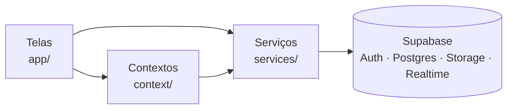

# ReservaGO 🏕️

[](https://github.com/IanCoutoFTT/Reserva_go/actions/workflows/ci.yml)

Aplicativo mobile para reservar cabanas e hospedagens isoladas, feito como Projeto Final de Curso (TCC) do 8º período. A ideia é parecida com a de plataformas como o Airbnb, mas com foco em refúgios na natureza: o hóspede busca, compara, conversa com o anfitrião e reserva direto pelo celular; o anfitrião anuncia as cabanas e acompanha as reservas; e um administrador modera tudo.

---

## Sumário

- [Funcionalidades](#funcionalidades)
- [Tecnologias](#tecnologias)
- [Arquitetura](#arquitetura)
- [Estrutura do projeto](#estrutura-do-projeto)
- [Como rodar](#como-rodar)
- [Gerando um APK](#gerando-um-apk)
- [Banco de dados](#banco-de-dados)
- [Segurança](#segurança)
- [Testes e CI](#testes-e-ci)
- [Limitações conhecidas](#limitações-conhecidas)
- [Solução de problemas](#solução-de-problemas)
- [Documentação adicional](#documentação-adicional)
- [Equipe](#equipe)
- [Licença](#licença)

---

## Funcionalidades

O sistema tem três perfis de usuário: **hóspede**, **anfitrião** e **administrador**. Quem entra pela primeira vez é hóspede e pode virar anfitrião pelo próprio app.

### Hóspede
- **Explorar** cabanas por categoria (Praia Privativa, Campo, Cachoeira), com busca por nome ou local e filtros por faixa de preço e nível de isolamento.
- **Detalhes** da cabana: fotos, descrição, comodidades, nível de isolamento, avaliações e dados do anfitrião.
- **Reservar** escolhendo as datas em um calendário que bloqueia dias passados e períodos já ocupados. O resumo mostra diárias, taxa de serviço (10%) e desconto de 5% no PIX.
- **Cancelar** reservas e acompanhar o histórico na aba Viagens.
- **Favoritar** cabanas, com sincronização no banco e cache local.
- **Conversar** com o anfitrião em tempo real (mensagens chegam na hora e são marcadas como lidas).
- **Avaliar** a hospedagem depois que a estadia termina.
- **Perfil** editável (nome, foto, bio, interesses) e **notificações** de reservas e mensagens.

### Anfitrião
- **Anunciar** uma cabana com fotos, preço, localização, categoria, comodidades e nível de isolamento. O anúncio entra como *pendente* e só aparece para os hóspedes depois da aprovação do administrador.
- **Painel do Anfitrião**: lista das próprias cabanas (com status: em análise, aprovado, reprovado), edição, exclusão e as **reservas recebidas**, com hóspede, datas, valor e situação.

### Administrador
- **Painel de controle** com estatísticas, ranking das cabanas mais reservadas e destaque de anúncios.
- **Moderação**: aprovar ou reprovar anúncios e tratar denúncias.
- **Suporte**: o chat de suporte é atendido por uma conta administradora.

### Requisitos funcionais

| Código | Requisito | Onde está |
|---|---|---|
| RF-001 | Explorar hospedagens por categoria | `app/(tabs)/index.tsx` |
| RF-002 | Buscar por nome, localização ou ambiente | `app/(tabs)/index.tsx`, `components/explorer/` |
| RF-003 | Ver detalhes da hospedagem | `app/details.tsx` |
| RF-004 | Reservar pelo aplicativo | `app/details.tsx`, `services/bookingService.ts` |
| RF-005 | Salvar favoritas | `context/FavoritesContext.tsx` |
| RF-006 | Mensagens entre hóspede e anfitrião | `app/(tabs)/messages.tsx` |
| RF-007 | Login com conta Google | `app/login.tsx`, `app/oauth-callback.tsx` |
| RF-008 | Editar perfil e foto | `app/(tabs)/profile.tsx` |
| RF-009 | Avaliar após a estadia | `app/review.tsx` |
| RF-010 | Moderação de denúncias e anúncios | `app/admin-dashboard.tsx` |

---

## Tecnologias

**Aplicativo**
- React Native 0.81 e Expo SDK 54 (New Architecture ligada)
- TypeScript em modo estrito
- Expo Router (rotas baseadas em arquivos)
- Lucide React Native (ícones)
- `expo-secure-store` e AsyncStorage (sessão e cache local)
- `expo-image-picker` (fotos do perfil e das cabanas)

**Backend**
- Supabase: PostgreSQL, Auth (Google via OAuth/PKCE), Storage e Realtime
- Row Level Security, triggers e funções SQL para as regras de negócio

**Qualidade e entrega**
- Jest, `jest-expo` e Testing Library
- GitHub Actions (verificação de tipos e testes a cada push)
- `expo-dev-client` e EAS Build (development build e APK)

---

## Arquitetura

O app não tem servidor próprio: ele conversa direto com o Supabase, e a segurança fica nas regras do banco.



- **`app/`**: telas e navegação.
- **`context/`**: estado global (autenticação, reservas, favoritos, notificações, anúncios).
- **`services/`**: toda a comunicação com o Supabase. Cada função devolve `{ data, error }`, então as telas tratam falhas do mesmo jeito.
- **`lib/`**: utilidades puras (formatação de moeda, regra de estadia concluída) e o cliente Supabase.

Usuário real nunca vê dados de exemplo: se o servidor falhar, a tela mostra um aviso com a opção de tentar de novo. Os dados de exemplo existem só para o login de teste visual, disponível apenas em desenvolvimento (`__DEV__`).

---

## Estrutura do projeto

```
Reserva_go/
├── app/                      # Telas e rotas (Expo Router)
│   ├── (tabs)/               # Abas: Explorar, Favoritos, Mensagens, Viagens, Perfil
│   ├── _layout.tsx           # Layout raiz e providers
│   ├── login.tsx             # Login com Google
│   ├── oauth-callback.tsx    # Retorno do OAuth (deep link)
│   ├── select-role.tsx       # Escolha entre hóspede e anfitrião
│   ├── details.tsx           # Detalhes da cabana e reserva
│   ├── review.tsx            # Avaliação da estadia
│   ├── create-listing.tsx    # Cadastro e edição de anúncio
│   ├── my-cabins.tsx         # Painel do anfitrião
│   ├── notifications.tsx     # Notificações
│   └── admin-dashboard.tsx   # Painel do administrador
├── components/               # Componentes reutilizáveis (explorer/, profile/)
├── context/                  # Auth, Booking, Favorites, Listing, Notification
├── services/                 # Acesso ao Supabase (um arquivo por assunto)
├── lib/                      # Cliente Supabase, formatação, regra de estadia
├── constants/                # Cores
├── supabase/
│   ├── schema.sql            # Esquema base do banco
│   ├── migrations/           # 001 a 013, aplicadas em ordem
│   └── seed.sql              # Dados de exemplo opcionais (ver observação abaixo)
├── docs/                     # Material de apoio ao TCC
├── .github/workflows/ci.yml  # Integração contínua
├── app.json                  # Configuração do Expo (scheme: reservago)
├── eas.json                  # Perfis de build (development, preview, production)
└── .env.example              # Modelo das variáveis de ambiente
```

---

## Como rodar

### Pré-requisitos

- [Node.js](https://nodejs.org/) 20 ou superior (é a versão usada no CI)
- [Git](https://git-scm.com/)
- Um projeto no [Supabase](https://supabase.com/) (o plano gratuito serve)
- Um projeto no Google Cloud com credenciais OAuth, para o login com Google
- Android Studio com um emulador, ou um celular Android, para rodar o app
- Conta no [Expo](https://expo.dev/) para gerar os builds com o EAS

### 1. Clonar e instalar

```bash
git clone https://github.com/IanCoutoFTT/Reserva_go.git
cd Reserva_go
npm install
```

### 2. Configurar o Supabase

1. Crie um projeto no Supabase.
2. No **SQL Editor**, rode o conteúdo de `supabase/schema.sql`.
3. Ainda no SQL Editor, rode **uma de cada vez, em ordem**, as migrações de `supabase/migrations/`, de `001` até `013` (a 013, do Pix, é opcional e só vale com o pagamento ligado: veja `docs/pagamento-pix.md`). Elas são idempotentes, então rodar de novo não causa problema.
4. Em **Authentication → Providers**, ative o **Google** e informe o Client ID e o Client Secret do Google Cloud.
5. Em **Authentication → URL Configuration → Redirect URLs**, adicione `reservago://oauth-callback`.
6. Em **Project Settings → API**, copie a URL do projeto e a chave `anon`.

> No plano gratuito, o Supabase **pausa o projeto depois de alguns dias sem uso**. Se o app começar a falhar de repente, abra o painel e clique em **Resume project**.

### 3. Variáveis de ambiente

```powershell
# PowerShell
Copy-Item .env.example .env
```

```bash
# macOS / Linux / Git Bash
cp .env.example .env
```

Edite o `.env`:

```
EXPO_PUBLIC_SUPABASE_URL=https://seu-projeto.supabase.co
EXPO_PUBLIC_SUPABASE_ANON_KEY=sua_chave_anon
```

O `.env` está no `.gitignore` e não deve ser commitado. A chave `anon` é pública por natureza (vai dentro do app); quem protege os dados são as regras do banco, descritas em [Segurança](#segurança).

### 4. Rodar o app

O login com Google **não funciona no Expo Go** (limitação do redirecionamento do próprio Expo Go). Por isso o projeto usa um *development build*:

```bash
# Gera o app de desenvolvimento (uma vez) e instale o APK no emulador/celular
npx eas-cli build --platform android --profile development

# Inicia o servidor de desenvolvimento
npx expo start --dev-client
```

Com o app instalado, abra-o e aponte para o servidor. No emulador Android, se a conexão com o Metro falhar, rode `adb reverse tcp:8081 tcp:8081`.

Para ver a interface sem configurar nada, em modo de desenvolvimento a tela de login mostra também um **login de teste visual**, que usa dados locais de exemplo e não grava nada no banco.

### 5. Criar a primeira conta administradora

Todo usuário novo entra como hóspede. Para promover alguém a administrador, faça o login uma vez e rode no SQL Editor:

```sql
UPDATE profiles SET role = 'admin' WHERE email = 'seu-email@exemplo.com';
```

(A troca de papel por aqui é permitida porque o SQL Editor roda com privilégios de administrador do banco. Pelo app, ninguém consegue se promover.)

### Dados de exemplo

O arquivo `supabase/seed.sql` é opcional e foi escrito antes das regras de moderação das migrações 006 e 007. O caminho mais seguro é cadastrar as cabanas pelo próprio app com uma conta de anfitrião e aprová-las com a conta de administrador.

---

## Gerando um APK

O `eas.json` tem o perfil `preview`, que gera um APK instalável sem depender do servidor de desenvolvimento, útil para apresentações:

```bash
npx eas-cli build --platform android --profile preview
```

**Atenção:** o EAS compila na nuvem a partir do repositório, e o `.env` não vai junto (está no `.gitignore`). Sem as variáveis, o APK sai apontando para um servidor inexistente. Cadastre `EXPO_PUBLIC_SUPABASE_URL` e `EXPO_PUBLIC_SUPABASE_ANON_KEY` nas variáveis de ambiente do projeto no Expo (painel, em *Environment variables*, ou pelo comando `eas env:create`) antes de gerar o build.

---

## Banco de dados

### Tabelas

| Tabela | Conteúdo |
|---|---|
| `profiles` | Perfil do usuário: nome, foto, papel, bio, interesses. E-mail e telefone são privados. |
| `properties` | Cabanas, com status (`pendente`, `ativo`, `suspenso`, `inativo`, `removido`). |
| `bookings` | Reservas, com datas, valores e status (`reservada`, `cancelada`, `realizada`). |
| `favorites` | Cabanas favoritas de cada usuário. |
| `reviews` | Avaliações das estadias. |
| `conversations` e `messages` | Chat entre hóspede e anfitrião. |
| `notifications` | Notificações de reservas, mensagens e avisos. |
| `reports` | Denúncias tratadas pelo administrador. |

Os arquivos de imagem ficam em dois buckets públicos do Storage: `avatars` (fotos de perfil) e `properties` (fotos das cabanas).

### Migrações

| Arquivo | O que faz |
|---|---|
| `001` | Impede que o usuário mude a própria role editando o perfil direto. |
| `002` | Esconde do público os perfis de contas excluídas. |
| `003` | Políticas de Storage para o bucket de avatares. |
| `004` | Política de criação de conversas. |
| `005` | Corrige a função que cria o perfil no primeiro login (`search_path`). |
| `006` | Segurança e integridade: moderação de anúncios, preço e datas das reservas, trava contra reservas sobrepostas, mensagens, avaliações, notificações e Storage de anúncios. |
| `007` | Privacidade: e-mail e telefone deixam de ser legíveis por outros usuários. |

Toda mudança no banco deve virar uma migração numerada nessa pasta. O banco em funcionamento já chegou a divergir do `schema.sql` uma vez, e foi assim que se aprendeu a registrar tudo.

---

## Segurança

Como o app fala direto com o banco, as regras ficam no próprio Postgres, e o que a interface esconde nunca é a única barreira.

- **RLS em todas as tabelas.** Cada usuário só lê e altera o que lhe pertence.
- **Moderação protegida.** O anfitrião não consegue aprovar o próprio anúncio nem alterar contadores e avaliação; isso é feito por um trigger.
- **Preço calculado no servidor.** O valor da reserva, as datas e a regra "o dono não reserva a própria cabana" são validados no banco, e o cliente não decide o total.
- **Sem reservas sobrepostas.** Uma *exclusion constraint* impede duas reservas ativas para a mesma cabana no mesmo período.
- **Avaliação só depois da estadia.** A policy de `reviews` exige uma reserva já finalizada.
- **Contato privado.** O acesso a `email` e `phone` em `profiles` é negado a todos; o próprio usuário recebe o perfil completo pela função `get_my_profile()`.
- **Funções sensíveis fechadas.** Criar notificações e trocar de papel só acontece por funções controladas (`SECURITY DEFINER` com `search_path` fixo).

---

## Testes e CI

```bash
npm test               # roda tudo
npm run test:watch     # reroda ao salvar
npx tsc --noEmit       # verificação de tipos
```

São **150 testes em 20 suítes**, cobrindo os contextos, os serviços e funções utilitárias. Todos usam o Supabase mockado, então nenhum depende de rede ou do banco real.

O workflow `.github/workflows/ci.yml` roda a verificação de tipos e os testes a cada push e em cada Pull Request.

As telas em si ainda não têm testes automatizados; elas foram validadas manualmente em um emulador Android.

---

## Limitações conhecidas

- **Pagamento simulado.** Pix e cartão não cobram de verdade; a integração com um gateway é o próximo passo natural.
- **Modo escuro não implementado.** A paleta existe, mas as telas usam cores fixas.
- **Status "realizada" não é gravado.** A estadia concluída é calculada pela data de saída (`lib/booking.ts`), com a mesma regra usada pelo banco nas avaliações.
- **Anfitrião não responde avaliações.** Hoje o hóspede avalia, mas não há resposta.
- **Sem notificações push.** As notificações existem apenas dentro do app.
- **iOS não validado.** O desenvolvimento e os testes foram feitos em Android.
- **Aviso do SecureStore.** O Expo avisa que o valor da sessão passa de 2048 bytes; o login funciona, mas o aviso pode virar erro em versões futuras do SDK.

---

## Solução de problemas

| Sintoma | Causa provável e solução |
|---|---|
| O app mostra "Não foi possível carregar" ou `Network request failed` | O Supabase pausou por inatividade (clique em **Resume project** no painel) ou o aparelho está sem internet. |
| O login com Google fica carregando ou não volta para o app | Não está usando o development build, ou falta `reservago://oauth-callback` em *Redirect URLs* no Supabase. |
| O app não conecta ao servidor de desenvolvimento no emulador | Rode `adb reverse tcp:8081 tcp:8081` e abra o app de novo. |
| O emulador abre mas nada resolve nomes (DNS) | Reinicie o emulador com `emulator -avd NOME -dns-server 8.8.8.8`. |
| O APK abre mas não carrega nenhum dado | O build foi gerado sem as variáveis `EXPO_PUBLIC_SUPABASE_*`; veja [Gerando um APK](#gerando-um-apk). |
| A entrada como administrador não mostra o painel | A conta ainda é hóspede; promova pelo SQL da seção [Criar a primeira conta administradora](#5-criar-a-primeira-conta-administradora). |
| A porta 8081 está ocupada | Há outro Metro rodando; encerre-o ou inicie com `npx expo start --port 8082`. |

---

## Documentação adicional

- [`docs/material-tcc.md`](docs/material-tcc.md): levantamento de telas, requisitos funcionais e não funcionais, escrito durante o desenvolvimento.
- [`PROJETO.md`](PROJETO.md): registro técnico do projeto e das decisões tomadas.

Os dois documentos são retratos de momentos anteriores do projeto e podem estar defasados em alguns detalhes. Em caso de dúvida, vale o código e este README.

---

## Equipe

| Nome | GitHub |
|---|---|
| Junior Prado | [@JuniorPrado99](https://github.com/JuniorPrado99) |
| Arthur Caixeta | [@ArthurCaixet0](https://github.com/ArthurCaixet0) |
| Ian Couto | [@IanCoutoFTT](https://github.com/IanCoutoFTT) |

---

## Licença

MIT. Veja o arquivo [LICENSE](LICENSE) para os detalhes.
